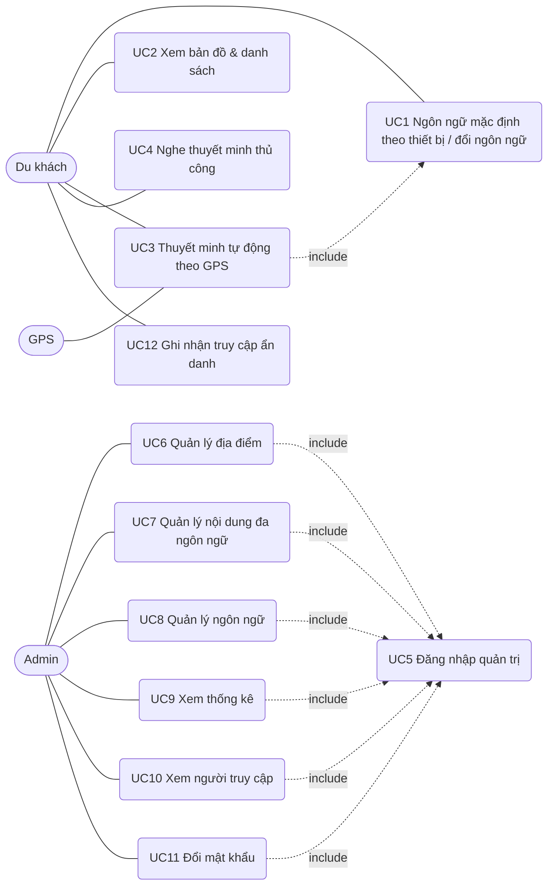
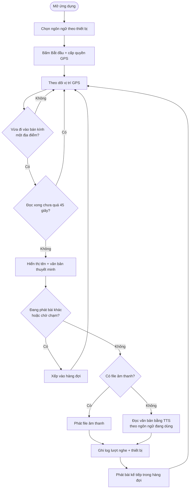
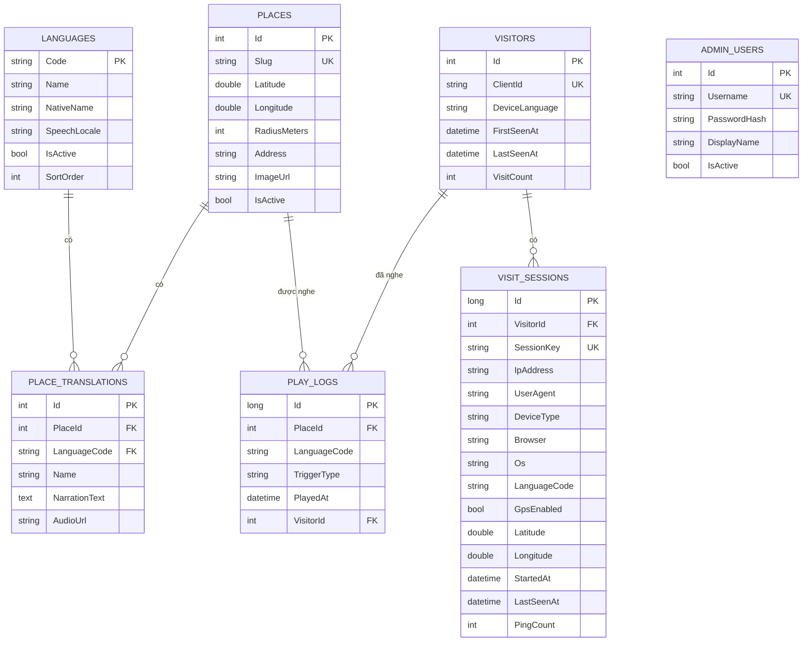

# Saigon Audio Guide — Focused Use Cases

**Version 1.1** · Theo mẫu "Focused Use Cases" (Course Cast) của giảng viên.
Tác giả: *[Tên nhóm]* · Ngày: 22-10-2026

## Actors
| Actor | Mô tả |
|---|---|
| Du khách (Tourist) | Người dùng ứng dụng, chọn ngôn ngữ và nghe thuyết minh |
| Quản trị viên (Admin) | Quản lý địa điểm, nội dung đa ngôn ngữ, ngôn ngữ, xem thống kê lượt nghe và người truy cập |
| GPS (hệ thống ngoài) | Cung cấp vị trí của thiết bị cho ứng dụng |

## Use Case Diagram

## Business Rules
| # | Quy tắc |
|---|---|
| BR1 | Mỗi địa điểm có tọa độ GPS và bán kính kích hoạt (20–2000 m, mặc định 80–120 m). |
| BR2 | Chế độ tự động chỉ kích hoạt khi du khách **đi vào** bán kính (không phát lặp lại khi đứng yên) và không phát lại cùng một địa điểm trong 45 giây kể từ khi đọc xong (và không phát lặp khi đang đọc chính địa điểm đó). Phải đi ra xa hơn bán kính 25 m thì lần vào lại sau mới được tính là "đi vào" (chống nhiễu GPS). Ở chế độ demo không áp dụng thời gian chờ. |
| BR3 | Nếu địa điểm chưa có bản dịch của ngôn ngữ đã chọn, hệ thống dùng tiếng Anh, rồi tiếng Việt. |
| BR4 | Chỉ quản trị viên đã đăng nhập (JWT) mới được thêm/sửa/xóa dữ liệu. |
| BR5 | Slug duy nhất, chỉ gồm chữ thường/số/gạch ngang; vĩ độ −90..90; kinh độ −180..180. |
| BR6 | Mỗi lượt phát được ghi log: địa điểm, ngôn ngữ, loại kích hoạt (gps/manual), thời gian. |
| BR7 | Ngôn ngữ bị tắt không hiển thị cho du khách và không bị xóa dữ liệu. |
| BR8 | Mật khẩu admin được băm PBKDF2-SHA256, không lưu dạng rõ; mật khẩu mới tối thiểu 8 ký tự. |
| BR9 | Ngôn ngữ mặc định là ngôn ngữ của thiết bị (`navigator.languages`/`Accept-Language`); nếu chưa được hỗ trợ thì dùng tiếng Anh. Du khách có thể chọn ngôn ngữ khác hoặc quay về "Tự động". |
| BR10 | Trình duyệt chỉ cho phát âm thanh sau lần chạm đầu tiên; nếu thuyết minh kích hoạt trước đó, hệ thống vẫn hiển thị chữ ngay và phát tiếng khi người dùng chạm lần đầu. |
| BR11 | Mỗi thiết bị có một `ClientId` ẩn danh (UUID tự sinh); mỗi tab là một phiên (`SessionKey`). Phiên được coi là "đang online" nếu có tín hiệu trong 90 giây gần nhất (ping mỗi 30 giây). |
| BR12 | Vị trí của du khách chỉ được lưu khi họ bật GPS thật (không lưu ở chế độ demo) và được làm tròn ~110 m. Giao diện có thông báo về việc ghi nhận ẩn danh. |
| BR13 | Các API công khai (ping, play-log) và đăng nhập admin bị giới hạn tần suất theo IP để chống spam / dò mật khẩu. |

---
## UC1 — Ngôn ngữ mặc định theo thiết bị / đổi ngôn ngữ
| | |
|---|---|
| **Use Case Number** | UC1 |
| **Use Case Name** | Ngôn ngữ mặc định theo thiết bị / đổi ngôn ngữ |
| **Actor(s)** | Du khách |
| **Maturity** | Focused |
| **Summary** | Ứng dụng tự dùng ngôn ngữ gốc của thiết bị; du khách có thể chọn ngôn ngữ khác bất kỳ lúc nào. |

| Actor Action | System Response |
|---|---|
| 1. Du khách mở ứng dụng. | 2. Hệ thống tải danh sách ngôn ngữ đang kích hoạt, đối chiếu với `navigator.languages` của thiết bị (vi-VN → vi, zh-TW → zh) và chọn ngôn ngữ phù hợp {BR9}. A2 |
| | 3. Hệ thống đổi chữ giao diện và tải danh sách địa điểm theo ngôn ngữ đó. Use case kết thúc. |
| 4. (Tùy chọn) Du khách chọn một ngôn ngữ trong ô chọn ở đầu trang. A1 | 5. Hệ thống lưu lựa chọn trên thiết bị, đổi giao diện và tải lại địa điểm. |

**Alternative Paths:** A1. Du khách chọn lại "Tự động (theo thiết bị)" → quay về bước 2. A2. Ngôn ngữ thiết bị chưa được hỗ trợ → dùng tiếng Anh.
**Exception Paths:** E1. Không tải được danh sách ngôn ngữ → hiển thị thông báo lỗi kết nối.
**Triggers:** Du khách mở ứng dụng hoặc muốn đổi ngôn ngữ. **Preconditions:** Không. **Business Rules:** BR3, BR7, BR9.

## UC2 — Xem bản đồ và danh sách địa điểm
| | |
|---|---|
| **Use Case Number** | UC2 |
| **Actor(s)** | Du khách |
| **Summary** | Xem các địa điểm du lịch trên bản đồ và trong danh sách, kèm khoảng cách đến vị trí hiện tại. |

| Actor Action | System Response |
|---|---|
| 1. Perform {UC1 Chọn ngôn ngữ}. | 2. Hệ thống hiển thị bản đồ, marker và vòng bán kính từng địa điểm, cùng danh sách bên dưới. |
| 3. Du khách cho phép định vị (hoặc bật chế độ demo). | 4. Hệ thống tính khoảng cách (Haversine), sắp xếp danh sách từ gần đến xa và đánh dấu địa điểm đang trong phạm vi. Use case kết thúc. |

**Exception Paths:** E1. Người dùng từ chối quyền định vị → hệ thống báo lỗi, hướng dẫn cấp lại quyền trong cài đặt trình duyệt hoặc dùng chế độ demo; nếu sau đó người dùng cấp quyền, hệ thống tự theo dõi lại. **Preconditions:** Ngôn ngữ đã chọn. **Business Rules:** BR1, BR3.

## UC3 — Thuyết minh tự động theo GPS
| | |
|---|---|
| **Use Case Number** | UC3 |
| **Actor(s)** | Du khách, GPS |
| **Summary** | Sau khi cấp quyền định vị, khi du khách đi vào bán kính của một địa điểm trên bản đồ, hệ thống tự động đọc và hiển thị thuyết minh (chữ tô sáng theo từng câu) bằng ngôn ngữ đang dùng, không cần thao tác thêm. |

| Actor Action | System Response |
|---|---|
| 1. Perform {UC1 Ngôn ngữ mặc định theo thiết bị}. | 2. Lần đầu: hiển thị màn hình chào và nút "Bắt đầu". Các lần sau: tự bắt đầu. |
| 3. Du khách bấm "Bắt đầu" và cho phép truy cập vị trí. | 4. Hệ thống theo dõi vị trí liên tục từ GPS, giữ màn hình sáng (nếu thiết bị hỗ trợ). |
| 5. GPS gửi vị trí mới. | 6. Hệ thống tính khoảng cách tới mọi địa điểm, xác định các địa điểm vừa "đi vào" bán kính {BR2}. A1, A5 |
| | 7. Nếu địa điểm đã đọc xong cách đây hơn 45 giây (hoặc chưa phát lần nào): hiển thị tên + văn bản thuyết minh và phát file âm thanh hoặc đọc bằng giọng của ngôn ngữ đã chọn, tô sáng câu đang đọc. A2, A3, A6 |
| | 8. Hệ thống ghi log lượt nghe (gps) kèm thiết bị. Khi đọc xong, phát tiếp địa điểm đang chờ trong hàng đợi (nếu còn đứng trong vùng). Use case kết thúc. |

**Alternative Paths:** A1. Không có địa điểm trong bán kính → hiển thị "Chưa có địa điểm nào trong phạm vi · Gần nhất: ... (… m)". A2. Đang phát bài khác → địa điểm mới vào hàng đợi, phát sau khi bài hiện tại xong. A3. Không tải được file âm thanh → chuyển sang giọng đọc tự động. A4. Du khách bấm "Dừng/Đóng" → dừng phát và xóa hàng đợi. A5. Sai số GPS > 200 m → báo "Tín hiệu GPS yếu", chưa kích hoạt. A6. Trình duyệt chưa cho phát âm thanh (chưa có lần chạm nào) → hiện chữ ngay, hiện nút "Chạm để nghe"; phát tiếng ở lần chạm đầu tiên {BR10}.
**Exception Paths:** E1. Từ chối quyền định vị / không lấy được GPS → báo lỗi, gợi ý cấp quyền hoặc dùng chế độ demo. E2. Thiết bị không có giọng đọc cho ngôn ngữ → hiển thị cảnh báo, vẫn hiển thị chữ.
**Triggers:** Du khách đi vào vùng kích hoạt. **Preconditions:** Đã cấp quyền định vị (hoặc bật demo). **Business Rules:** BR1, BR2, BR3, BR6, BR10.

## UC4 — Nghe thuyết minh thủ công
| | |
|---|---|
| **Use Case Number** | UC4 |
| **Actor(s)** | Du khách |
| **Summary** | Du khách chọn một địa điểm từ danh sách/bản đồ để nghe thuyết minh, không cần GPS. |

| Actor Action | System Response |
|---|---|
| 1. Du khách bấm "Nghe" hoặc chạm marker. | 2. Hệ thống dừng bài đang phát (nếu có), hiển thị nội dung và phát thuyết minh theo ngôn ngữ đã chọn. |
| | 3. Hệ thống ghi log lượt nghe (manual). Use case kết thúc. |

**Alternative Paths:** A1. Du khách bấm "Dừng". **Exception Paths:** E1. Ghi log thất bại → bỏ qua, không ảnh hưởng việc phát. **Preconditions:** Đã chọn ngôn ngữ. **Business Rules:** BR3, BR6.

## UC5 — Đăng nhập quản trị
| | |
|---|---|
| **Use Case Number** | UC5 |
| **Actor(s)** | Admin |
| **Summary** | Admin đăng nhập để sử dụng các chức năng quản trị. |

| Actor Action | System Response |
|---|---|
| 1. Admin nhập tên đăng nhập và mật khẩu, bấm "Đăng nhập". | 2. Hệ thống kiểm tra tài khoản đang hoạt động và so khớp mật khẩu đã băm. |
| | 3. Hệ thống cấp JWT, hiển thị trang quản trị. Use case kết thúc. |

**Exception Paths:** E1. Sai thông tin đăng nhập → thông báo "Sai tên đăng nhập hoặc mật khẩu", quay lại bước 1. E2. Token hết hạn → chuyển về trang đăng nhập.
**Preconditions:** Admin chưa có phiên đăng nhập. **Business Rules:** BR4, BR8.

## UC6 — Quản lý địa điểm
| | |
|---|---|
| **Use Case Number** | UC6 |
| **Actor(s)** | Admin |
| **Summary** | Thêm, sửa, ẩn/hiện, xóa địa điểm du lịch (tọa độ, bán kính, địa chỉ, ảnh). |

| Actor Action | System Response |
|---|---|
| 1. Perform {UC5 Đăng nhập quản trị}. | 2. Hệ thống hiển thị danh sách địa điểm. |
| 3. Admin chọn Thêm / Sửa / Xóa. A1 | 4. Với Thêm/Sửa: hiển thị biểu mẫu. Với Xóa: yêu cầu xác nhận. |
| 5. Admin nhập thông tin và bấm Lưu. | 6. Hệ thống kiểm tra dữ liệu {BR5}, lưu vào MySQL và cập nhật danh sách. Use case kết thúc. |

**Alternative Paths:** A1. Admin đặt trạng thái "Ẩn" → địa điểm không hiển thị cho du khách.
**Exception Paths:** E1. Dữ liệu không hợp lệ hoặc slug trùng → hiển thị lỗi, giữ nguyên biểu mẫu. E2. Xóa địa điểm không tồn tại → báo 404.
**Preconditions:** Đã đăng nhập. **Business Rules:** BR1, BR4, BR5.

## UC7 — Quản lý nội dung thuyết minh đa ngôn ngữ
| | |
|---|---|
| **Use Case Number** | UC7 |
| **Actor(s)** | Admin |
| **Summary** | Nhập/sửa/xóa tên địa điểm, văn bản thuyết minh và file âm thanh cho từng ngôn ngữ. |

| Actor Action | System Response |
|---|---|
| 1. Perform {UC5 Đăng nhập quản trị}. | |
| 2. Admin mở một địa điểm. | 3. Hệ thống hiển thị khối nội dung cho từng ngôn ngữ đang kích hoạt. |
| 4. Admin nhập tên, văn bản, (tùy chọn) dán URL hoặc tải lên file âm thanh (mp3/m4a/wav/ogg ≤ 15 MB), bấm "Lưu bản dịch". A1 | 5. Hệ thống kiểm tra độ dài, định dạng URL/file; thêm mới hoặc cập nhật bản dịch. Use case kết thúc. |

**Alternative Paths:** A1. Admin bấm "Nghe thử" để nghe văn bản bằng giọng đọc của trình duyệt. A2. Admin bấm "Xóa bản dịch".
**Exception Paths:** E1. Thiếu tên/văn bản hoặc vượt giới hạn (200/4000 ký tự) → báo lỗi.
**Preconditions:** Địa điểm và ngôn ngữ đã tồn tại. **Business Rules:** BR3, BR4.

## UC8 — Quản lý ngôn ngữ
| | |
|---|---|
| **Use Case Number** | UC8 |
| **Actor(s)** | Admin |
| **Summary** | Thêm ngôn ngữ mới, sửa tên/locale giọng đọc/thứ tự, bật/tắt ngôn ngữ. |

| Actor Action | System Response |
|---|---|
| 1. Perform {UC5 Đăng nhập quản trị}. | 2. Hệ thống hiển thị danh sách ngôn ngữ. |
| 3. Admin sửa một dòng hoặc nhập ngôn ngữ mới rồi bấm Lưu/Thêm. | 4. Hệ thống kiểm tra mã ngôn ngữ, lưu và cập nhật. Use case kết thúc. |

**Exception Paths:** E1. Mã ngôn ngữ sai định dạng hoặc đã tồn tại → báo lỗi. **Preconditions:** Đã đăng nhập. **Business Rules:** BR4, BR7.

## UC9 — Xem thống kê lượt nghe
| | |
|---|---|
| **Use Case Number** | UC9 |
| **Actor(s)** | Admin |
| **Summary** | Xem tổng lượt nghe, tỷ lệ tự động/thủ công, địa điểm nổi bật và phân bố theo ngôn ngữ. |

| Actor Action | System Response |
|---|---|
| 1. Perform {UC5 Đăng nhập quản trị}. | |
| 2. Admin mở tab "Thống kê". A1 | 3. Hệ thống tổng hợp log trong 30 ngày gần nhất và hiển thị. Use case kết thúc. |

**Alternative Paths:** A1. Admin đổi khoảng thời gian (7/30/90/365 ngày). **Exception Paths:** Không. **Business Rules:** BR6.

## UC10 — Xem người truy cập
| | |
|---|---|
| **Use Case Number** | UC10 |
| **Actor(s)** | Admin |
| **Summary** | Xem ai đang truy cập hệ thống ngay lúc này và lịch sử truy cập: thiết bị, trình duyệt, IP, ngôn ngữ, vị trí gần đúng, số lượt nghe. |

| Actor Action | System Response |
|---|---|
| 1. Perform {UC5 Đăng nhập quản trị}. | |
| 2. Admin mở tab "Truy cập". A1 | 3. Hệ thống hiển thị số người đang online, số lượt truy cập, số thiết bị khác nhau, khách mới/quay lại, biểu đồ theo ngày, phân bố thiết bị/ngôn ngữ. |
| | 4. Hệ thống hiển thị danh sách "Đang online" (tự làm mới 15 giây) và lịch sử truy cập phân trang. Use case kết thúc. |

**Alternative Paths:** A1. Admin đổi khoảng thời gian (24 giờ/7/30/90 ngày) hoặc chuyển trang lịch sử.
**Exception Paths:** E1. Token hết hạn → về trang đăng nhập. **Preconditions:** Đã đăng nhập. **Business Rules:** BR4, BR11, BR12.

## UC11 — Đổi mật khẩu quản trị
| | |
|---|---|
| **Use Case Number** | UC11 |
| **Actor(s)** | Admin |
| **Summary** | Admin đổi mật khẩu mặc định sang mật khẩu riêng. |

| Actor Action | System Response |
|---|---|
| 1. Perform {UC5 Đăng nhập quản trị}. | |
| 2. Admin bấm "Đổi mật khẩu", nhập mật khẩu hiện tại, mật khẩu mới (2 lần). | 3. Hệ thống kiểm tra mật khẩu hiện tại, độ dài ≥ 8 và khác mật khẩu cũ, băm lại và lưu. Use case kết thúc. |

**Exception Paths:** E1. Sai mật khẩu hiện tại / mật khẩu mới quá ngắn hoặc trùng cũ / hai lần nhập không khớp → báo lỗi. **Business Rules:** BR4, BR8.

## UC12 — Ghi nhận truy cập ẩn danh
| | |
|---|---|
| **Use Case Number** | UC12 |
| **Actor(s)** | Du khách (ngầm định), Hệ thống |
| **Summary** | Khi du khách mở ứng dụng, trình duyệt định kỳ báo cho máy chủ để admin biết ai đang online. |

| Actor Action | System Response |
|---|---|
| 1. Du khách mở ứng dụng. | 2. Trình duyệt tạo (hoặc đọc lại) `ClientId` và `SessionKey`, gửi ping (ngôn ngữ thiết bị, ngôn ngữ đang dùng, vị trí gần đúng nếu bật GPS thật). |
| | 3. Hệ thống tạo/cập nhật `Visitor` và `VisitSession`, phân tích User-Agent (loại thiết bị, trình duyệt, hệ điều hành), lấy IP (qua X-Forwarded-For nếu sau proxy tin cậy). |
| 4. Trình duyệt ping lại mỗi 30 giây khi trang đang hiển thị. | 5. Hệ thống làm mới `LastSeenAt`. Use case kết thúc. |

**Exception Paths:** E1. Ping lỗi hoặc bị giới hạn tần suất (429) → bỏ qua, không ảnh hưởng trải nghiệm. **Business Rules:** BR11, BR12, BR13.

---
## Activity Diagram — UC3

## ERD

