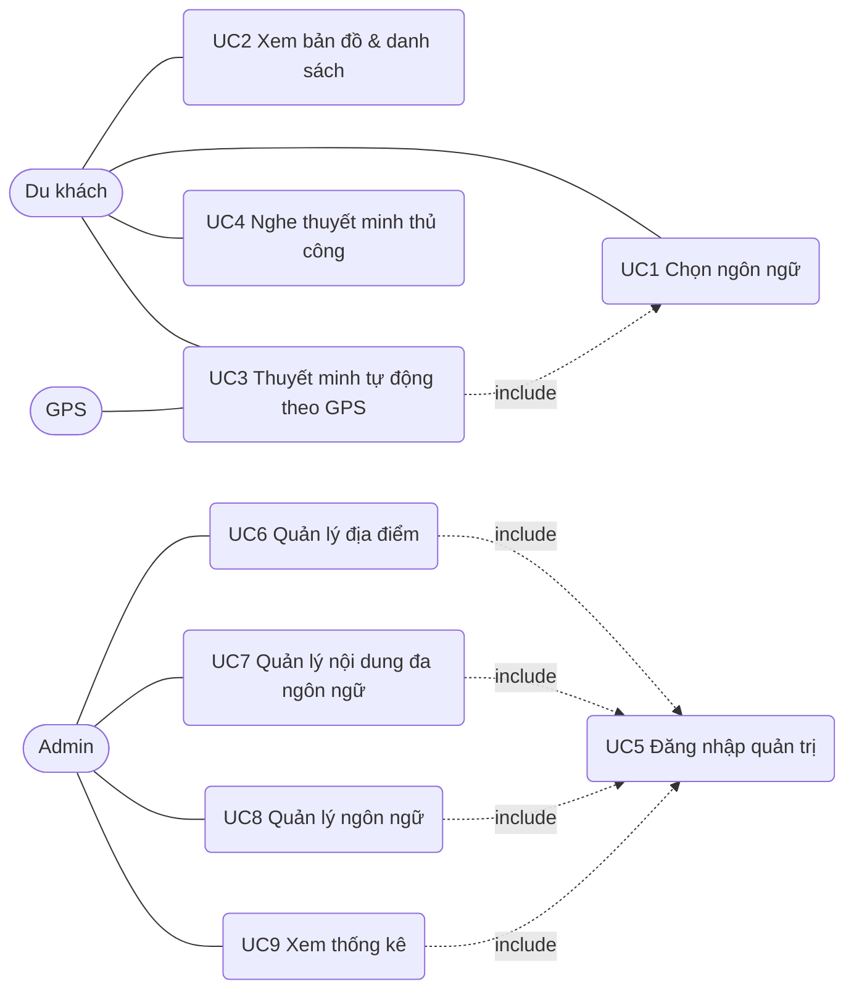
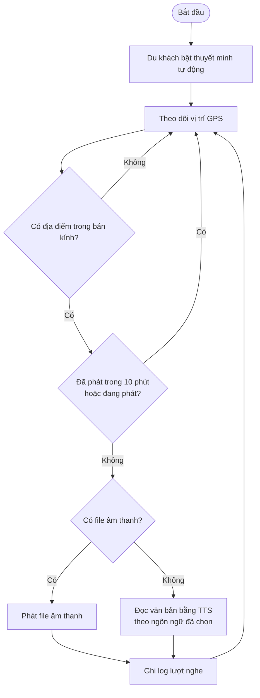
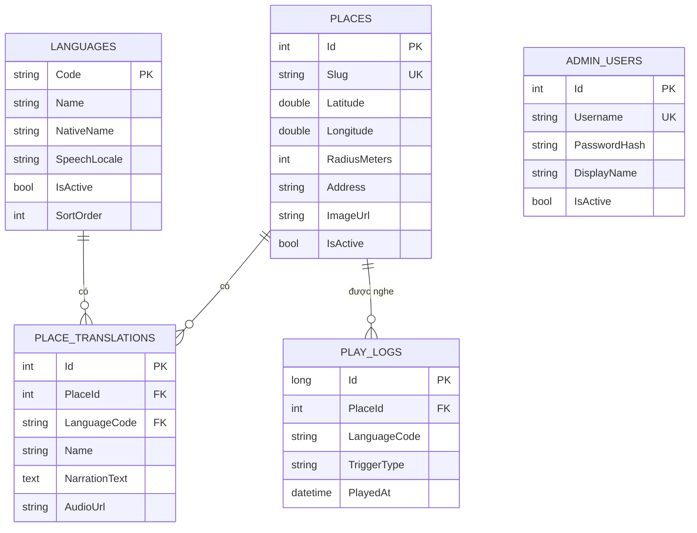

# Saigon Audio Guide — Focused Use Cases

**Version 1.0** · Theo mẫu "Focused Use Cases" (Course Cast) của giảng viên.
Tác giả: *[Tên nhóm]* · Ngày: 22-10-2026

## Actors
| Actor | Mô tả |
|---|---|
| Du khách (Tourist) | Người dùng ứng dụng, chọn ngôn ngữ và nghe thuyết minh |
| Quản trị viên (Admin) | Quản lý địa điểm, nội dung đa ngôn ngữ, ngôn ngữ, xem thống kê |
| GPS (hệ thống ngoài) | Cung cấp vị trí của thiết bị cho ứng dụng |

## Use Case Diagram

## Business Rules
| # | Quy tắc |
|---|---|
| BR1 | Mỗi địa điểm có tọa độ GPS và bán kính kích hoạt (20–2000 m, mặc định 80–120 m). |
| BR2 | Chế độ tự động không phát lại cùng một địa điểm trong 10 phút. |
| BR3 | Nếu địa điểm chưa có bản dịch của ngôn ngữ đã chọn, hệ thống dùng tiếng Anh, rồi tiếng Việt. |
| BR4 | Chỉ quản trị viên đã đăng nhập (JWT) mới được thêm/sửa/xóa dữ liệu. |
| BR5 | Slug duy nhất, chỉ gồm chữ thường/số/gạch ngang; vĩ độ −90..90; kinh độ −180..180. |
| BR6 | Mỗi lượt phát được ghi log: địa điểm, ngôn ngữ, loại kích hoạt (gps/manual), thời gian. |
| BR7 | Ngôn ngữ bị tắt không hiển thị cho du khách và không bị xóa dữ liệu. |
| BR8 | Mật khẩu admin được băm PBKDF2-SHA256, không lưu dạng rõ. |

---
## UC1 — Chọn ngôn ngữ
| | |
|---|---|
| **Use Case Number** | UC1 |
| **Use Case Name** | Chọn ngôn ngữ |
| **Actor(s)** | Du khách |
| **Maturity** | Focused |
| **Summary** | Du khách chọn ngôn ngữ giao diện và ngôn ngữ nghe thuyết minh. |

| Actor Action | System Response |
|---|---|
| 1. Du khách mở ứng dụng. | 2. Hệ thống tải danh sách ngôn ngữ đang kích hoạt; nếu chưa có lựa chọn đã lưu thì hiện hộp thoại chọn ngôn ngữ. |
| 3. Du khách chọn một ngôn ngữ. A1 | 4. Hệ thống lưu lựa chọn trên thiết bị, đổi chữ giao diện, tải lại danh sách địa điểm theo ngôn ngữ. Use case kết thúc. |

**Alternative Paths:** A1. Du khách bấm nút "Đổi ngôn ngữ" ở bất kỳ lúc nào → quay lại bước 2.
**Exception Paths:** E1. Không tải được danh sách ngôn ngữ → hiển thị thông báo lỗi kết nối.
**Triggers:** Du khách mở ứng dụng hoặc muốn đổi ngôn ngữ. **Preconditions:** Không. **Business Rules:** BR3, BR7.

## UC2 — Xem bản đồ và danh sách địa điểm
| | |
|---|---|
| **Use Case Number** | UC2 |
| **Actor(s)** | Du khách |
| **Summary** | Xem các địa điểm du lịch trên bản đồ và trong danh sách, kèm khoảng cách đến vị trí hiện tại. |

| Actor Action | System Response |
|---|---|
| 1. Perform {UC1 Chọn ngôn ngữ}. | 2. Hệ thống hiển thị bản đồ, marker và vòng bán kính từng địa điểm, cùng danh sách bên dưới. |
| 3. Du khách bật GPS hoặc chế độ demo. | 4. Hệ thống tính khoảng cách (Haversine) và sắp xếp danh sách từ gần đến xa. Use case kết thúc. |

**Exception Paths:** E1. Người dùng từ chối quyền định vị → hệ thống báo lỗi và gợi ý dùng chế độ demo. **Preconditions:** Ngôn ngữ đã chọn. **Business Rules:** BR1, BR3.

## UC3 — Thuyết minh tự động theo GPS
| | |
|---|---|
| **Use Case Number** | UC3 |
| **Actor(s)** | Du khách, GPS |
| **Summary** | Khi du khách đi vào bán kính của một địa điểm, hệ thống tự động đọc thuyết minh bằng ngôn ngữ đã chọn. |

| Actor Action | System Response |
|---|---|
| 1. Perform {UC1 Chọn ngôn ngữ}. | |
| 2. Du khách bấm "Bật thuyết minh tự động". | 3. Hệ thống theo dõi vị trí liên tục từ GPS. |
| 4. GPS gửi vị trí mới. | 5. Hệ thống tính khoảng cách tới mọi địa điểm, tìm địa điểm gần nhất nằm trong bán kính. A1, A2 |
| | 6. Nếu địa điểm chưa phát trong 10 phút và không có bản thuyết minh đang phát: phát file âm thanh hoặc đọc văn bản bằng giọng của ngôn ngữ đã chọn. A3 |
| | 7. Hệ thống ghi log lượt nghe (gps). Khi đọc xong, kiểm tra lại vị trí. Use case kết thúc. |

**Alternative Paths:** A1. Không có địa điểm nào trong bán kính → hiển thị "Chưa có địa điểm nào trong phạm vi". A2. Đang phát bài khác → chờ phát xong rồi kiểm tra lại. A3. Không tải được file âm thanh → chuyển sang giọng đọc tự động. A4. Du khách bấm "Dừng" → dừng phát.
**Exception Paths:** E1. Không lấy được GPS → báo lỗi, gợi ý chế độ demo. E2. Thiết bị không có giọng đọc cho ngôn ngữ → hiển thị cảnh báo.
**Triggers:** Du khách đi vào vùng kích hoạt. **Preconditions:** Đã chọn ngôn ngữ, đã cấp quyền định vị (hoặc bật demo). **Business Rules:** BR1, BR2, BR3, BR6.

## UC4 — Nghe thuyết minh thủ công
| | |
|---|---|
| **Use Case Number** | UC4 |
| **Actor(s)** | Du khách |
| **Summary** | Du khách chọn một địa điểm từ danh sách/bản đồ để nghe thuyết minh, không cần GPS. |

| Actor Action | System Response |
|---|---|
| 1. Du khách bấm "Nghe" hoặc chạm marker. | 2. Hệ thống dừng bài đang phát (nếu có), hiển thị nội dung và phát thuyết minh theo ngôn ngữ đã chọn. |
| | 3. Hệ thống ghi log lượt nghe (manual). Use case kết thúc. |

**Alternative Paths:** A1. Du khách bấm "Dừng". **Exception Paths:** E1. Ghi log thất bại → bỏ qua, không ảnh hưởng việc phát. **Preconditions:** Đã chọn ngôn ngữ. **Business Rules:** BR3, BR6.

## UC5 — Đăng nhập quản trị
| | |
|---|---|
| **Use Case Number** | UC5 |
| **Actor(s)** | Admin |
| **Summary** | Admin đăng nhập để sử dụng các chức năng quản trị. |

| Actor Action | System Response |
|---|---|
| 1. Admin nhập tên đăng nhập và mật khẩu, bấm "Đăng nhập". | 2. Hệ thống kiểm tra tài khoản đang hoạt động và so khớp mật khẩu đã băm. |
| | 3. Hệ thống cấp JWT, hiển thị trang quản trị. Use case kết thúc. |

**Exception Paths:** E1. Sai thông tin đăng nhập → thông báo "Sai tên đăng nhập hoặc mật khẩu", quay lại bước 1. E2. Token hết hạn → chuyển về trang đăng nhập.
**Preconditions:** Admin chưa có phiên đăng nhập. **Business Rules:** BR4, BR8.

## UC6 — Quản lý địa điểm
| | |
|---|---|
| **Use Case Number** | UC6 |
| **Actor(s)** | Admin |
| **Summary** | Thêm, sửa, ẩn/hiện, xóa địa điểm du lịch (tọa độ, bán kính, địa chỉ, ảnh). |

| Actor Action | System Response |
|---|---|
| 1. Perform {UC5 Đăng nhập quản trị}. | 2. Hệ thống hiển thị danh sách địa điểm. |
| 3. Admin chọn Thêm / Sửa / Xóa. A1 | 4. Với Thêm/Sửa: hiển thị biểu mẫu. Với Xóa: yêu cầu xác nhận. |
| 5. Admin nhập thông tin và bấm Lưu. | 6. Hệ thống kiểm tra dữ liệu {BR5}, lưu vào MySQL và cập nhật danh sách. Use case kết thúc. |

**Alternative Paths:** A1. Admin đặt trạng thái "Ẩn" → địa điểm không hiển thị cho du khách.
**Exception Paths:** E1. Dữ liệu không hợp lệ hoặc slug trùng → hiển thị lỗi, giữ nguyên biểu mẫu. E2. Xóa địa điểm không tồn tại → báo 404.
**Preconditions:** Đã đăng nhập. **Business Rules:** BR1, BR4, BR5.

## UC7 — Quản lý nội dung thuyết minh đa ngôn ngữ
| | |
|---|---|
| **Use Case Number** | UC7 |
| **Actor(s)** | Admin |
| **Summary** | Nhập/sửa/xóa tên địa điểm, văn bản thuyết minh và file âm thanh cho từng ngôn ngữ. |

| Actor Action | System Response |
|---|---|
| 1. Perform {UC5 Đăng nhập quản trị}. | |
| 2. Admin mở một địa điểm. | 3. Hệ thống hiển thị khối nội dung cho từng ngôn ngữ đang kích hoạt. |
| 4. Admin nhập tên, văn bản, (tùy chọn) URL file mp3, bấm "Lưu bản dịch". A1 | 5. Hệ thống kiểm tra độ dài, định dạng URL; thêm mới hoặc cập nhật bản dịch. Use case kết thúc. |

**Alternative Paths:** A1. Admin bấm "Nghe thử" để nghe văn bản bằng giọng đọc của trình duyệt. A2. Admin bấm "Xóa bản dịch".
**Exception Paths:** E1. Thiếu tên/văn bản hoặc vượt giới hạn (200/4000 ký tự) → báo lỗi.
**Preconditions:** Địa điểm và ngôn ngữ đã tồn tại. **Business Rules:** BR3, BR4.

## UC8 — Quản lý ngôn ngữ
| | |
|---|---|
| **Use Case Number** | UC8 |
| **Actor(s)** | Admin |
| **Summary** | Thêm ngôn ngữ mới, sửa tên/locale giọng đọc/thứ tự, bật/tắt ngôn ngữ. |

| Actor Action | System Response |
|---|---|
| 1. Perform {UC5 Đăng nhập quản trị}. | 2. Hệ thống hiển thị danh sách ngôn ngữ. |
| 3. Admin sửa một dòng hoặc nhập ngôn ngữ mới rồi bấm Lưu/Thêm. | 4. Hệ thống kiểm tra mã ngôn ngữ, lưu và cập nhật. Use case kết thúc. |

**Exception Paths:** E1. Mã ngôn ngữ sai định dạng hoặc đã tồn tại → báo lỗi. **Preconditions:** Đã đăng nhập. **Business Rules:** BR4, BR7.

## UC9 — Xem thống kê lượt nghe
| | |
|---|---|
| **Use Case Number** | UC9 |
| **Actor(s)** | Admin |
| **Summary** | Xem tổng lượt nghe, tỷ lệ tự động/thủ công, địa điểm nổi bật và phân bố theo ngôn ngữ. |

| Actor Action | System Response |
|---|---|
| 1. Perform {UC5 Đăng nhập quản trị}. | |
| 2. Admin mở tab "Thống kê". A1 | 3. Hệ thống tổng hợp log trong 30 ngày gần nhất và hiển thị. Use case kết thúc. |

**Alternative Paths:** A1. Admin đổi khoảng thời gian (7/30/90/365 ngày). **Exception Paths:** Không. **Business Rules:** BR6.

---
## Activity Diagram — UC3

## ERD

